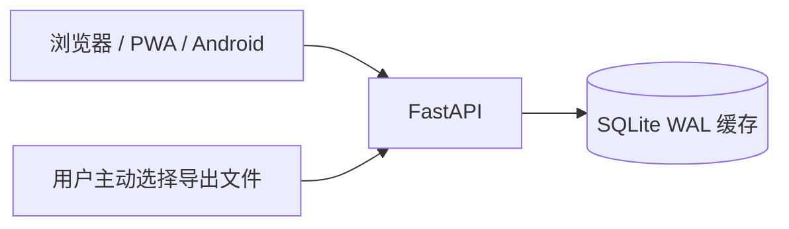

# 航的助手 · Hand Helper

个人使用的学习助手：React PWA / Android 外壳、FastAPI、SQLite WAL。课程表与成绩分析均通过你主动上传教务系统导出的文件写入本地缓存；后端不会登录、抓取或自动请求教务系统。

> **公开说明：** 本仓库公开仅用于使用 GitHub Actions 构建与验证；它仍是个人自用项目，不提供托管服务、账号或数据集，也不接受真实凭据、课程表或成绩数据。除非另行添加 `LICENSE`，代码与素材均保留所有权利，不授予再分发或商用许可。



## 本地开发

```powershell
Copy-Item .env.example .env
cd backend
python -m venv .venv
.\.venv\Scripts\Activate.ps1
pip install -e ".[dev]"
alembic upgrade head
..\scripts\dev.ps1 backend
```

另开终端：

```powershell
cd web
npm install
npm run dev -- --host 0.0.0.0
```

`.env` 需配置 Argon2id 格式的 `ADMIN_PASSWORD_HASH`、随机 `SESSION_SECRET`、数据库地址和可信 CORS 域名。生成哈希可执行 `cd backend; .\.venv\Scripts\python.exe -m tools.generate_password_hash`；不要提交 `.env` 或数据库文件。

## 导入数据

- 课程表：在教务系统切换到目标学期，在“学期理论课表”使用“打印”导出 `.xls`，再到课程表页导入。首次导入后，在“时间设置”填写该学期第一周周一。
- 成绩分析：在成绩页导出或保存 `.xls` / HTML 成绩表，在“成绩分析”页导入，核对预览后确认保存。确认导入会替换该学期旧成绩缓存；原文件不会长期保存。
- 可选 AI 成绩分析：在“设置 → 成绩分析设置”填写 HTTPS OpenAI 兼容服务和 API Key。APIKEY.FAN 可直接使用预设地址 `https://api.apikey.fan/v1`；先点“读取可用模型”，从供应商授权的模型列表中选择，再用“测试连接”验证。读取和测试都不会发送成绩或保存未确认的密钥。旧 APIKEY.FUN 预设会显示安全迁移按钮：它先以已加密保存的 Key 从新地址读取模型，成功后才更新配置。需额外在 `.env` 设置 `AI_CREDENTIAL_MASTER_KEY` 才能安全保存密钥；模型调用仅在点击“生成分析”时发生。

## 测试

```powershell
cd backend
.\.venv\Scripts\python.exe -m pytest -q

cd ..\web
npm run build
```


## Docker 与 Nginx

```bash
cp .env.example .env
cd deploy && docker compose up -d --build
```

生产环境把 `CORS_ORIGINS` 配为自己的 HTTPS 域名，不能使用 `*`。详见 [部署说明](docs/deployment.md) 和 [安全说明](docs/security.md)。
